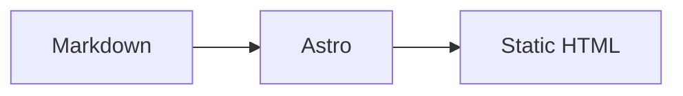

## Standard Markdown

The theme supports CommonMark and GFM:

- Headings, paragraphs, emphasis and strikethrough
- Ordered / unordered lists and task lists
- Blockquotes and horizontal rules
- Tables
- Inline code and fenced code blocks
- Links and images
- Footnotes

Code blocks use Shiki with copy buttons, language labels and light / dark themes.

## Callouts

```md
:::note{type=info}
A simple callout.
:::

:::note{type=success title="Done"}
A callout with a title.
:::

:::note{type=danger icon="fa-solid fa-bolt"}
A callout with an icon.
:::
```

Common types: `default`, `primary`, `success`, `info`, `warning`, `danger`, `red`, `yellow`, `green`, `blue`, `orange`, `purple`.

`:::callout` and `:::notel` are aliases with the same behavior.

## Folding

```md
::::folding[Click to expand]{style=blue}
Hidden content.
::::
```

Folding renders as native `<details>` and supports `open`:

```md
::::folding[Open by default]{style=green open}
Content.
::::
```

## Tabs

`tabs` contains multiple `tab` containers. Because `remark-directive` uses colon count for nesting, the outer block needs four colons and inner tabs need three:

```md
::::tabs{name="example"}
:::tab[First]
First content.
:::
:::tab[Second]
Second content.
:::
::::
```

- `name` generates a stable tab id.
- `active` selects the initial tab, starting at 1.
- `:::tab[Title]{icon="fa-solid fa-star"}` adds an icon.

## Buttons

```md
::button[Read the docs]{href="https://docs.example.com" icon="fa-solid fa-book" size=lg align=center}
```

| Attribute | Description |
| --- | --- |
| `href` | Link target; omit for a button without navigation |
| `icon` | Font Awesome icon class |
| `image` | Icon image URL, alternative to `icon` |
| `size` | `sm` / `md` / `lg` |
| `align` | `left` / `center` / `right` |
| `target` / `rel` | Link target and rel |

## Grid

```md
:::grid{cols=2 gap=16}
::button[Home]{href="/" icon="fa-solid fa-house"}
::button[Archives]{href="/archives/" icon="fa-solid fa-box-archive"}
:::
```

`cols` is the number of columns. `gap` accepts pixels or any CSS length. Grids can contain buttons, images and other block Markdown.

## Mermaid

Use a `mermaid` code fence:

````md

````

Mermaid is rendered on the client and loaded only on pages that contain diagrams.

## Nesting

Any module that contains another `:::` container needs an extra colon on the outer block:

```md
::::folding[Contains a callout]{style=blue}
:::note{type=info}
Nested content.
:::
::::
```

This is the standard Markdown directive nesting rule.
