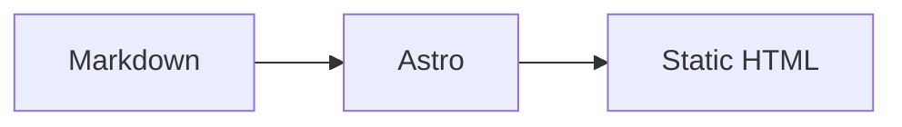

## 标准 Markdown

主题支持 CommonMark 与 GFM：

- 标题、段落、强调、删除线
- 有序 / 无序列表、任务列表
- 引用、分隔线
- 表格
- 行内代码与围栏代码块
- 链接、图片
- 脚注

代码块使用 Shiki 高亮，支持复制按钮、语言标签和明暗主题。

## 提示块

```md
:::note{type=info}
默认样式的提示块。
:::

:::note{type=success title="完成"}
带标题的提示块。
:::

:::note{type=danger icon="fa-solid fa-bolt"}
带图标的提示块。
:::
```

常用类型：`default`、`primary`、`success`、`info`、`warning`、`danger`、`red`、`yellow`、`green`、`blue`、`orange`、`purple`。

也可以使用 `:::callout` 和 `:::notel`，效果与带标题的提示块一致。

## 折叠面板

```md
::::folding[点击展开]{style=blue}
折叠区域内的内容。
::::
```

`folding` 渲染为原生 `<details>`，支持 `open` 默认展开：

```md
::::folding[默认展开]{style=green open}
内容。
::::
```

## 标签页

`tabs` 包含多个 `tab`。因为 `remark-directive` 用冒号数量表示嵌套层级，**外层使用四个冒号，内层使用三个冒号**：

```md
::::tabs{name="example"}
:::tab[第一项]
第一项的内容。
:::
:::tab[第二项]
第二项的内容。
:::
::::
```

- `name` 用于生成稳定的 tab id。
- `active` 指定默认激活的标签序号，从 1 开始。
- `:::tab[标题]{icon="fa-solid fa-star"}` 可以添加图标。

## 按钮

```md
::button[阅读文档]{href="https://docs.example.com" icon="fa-solid fa-book" size=lg align=center}
```

| 属性 | 说明 |
| --- | --- |
| `href` | 链接地址，省略时渲染为无链接按钮 |
| `icon` | Font Awesome 图标类名 |
| `image` | 图标图片地址，和 `icon` 二选一 |
| `size` | `sm` / `md` / `lg` |
| `align` | `left` / `center` / `right` |
| `target` / `rel` | 链接目标与 rel |

## 网格

```md
:::grid{cols=2 gap=16}
::button[首页]{href="/" icon="fa-solid fa-house"}
::button[归档]{href="/archives/" icon="fa-solid fa-box-archive"}
:::
```

`cols` 是列数，`gap` 支持像素数值或 CSS 长度。网格内可以放按钮、图片和其他块级 Markdown。

## Mermaid

使用 `mermaid` 代码块：

````md

````

Mermaid 由客户端渲染，只在包含图表的页面加载库。

## 嵌套规则

任何包含其他 `:::` 容器的模块，外层都需要增加一个冒号：

```md
::::folding[包含提示块]{style=blue}
:::note{type=info}
嵌套内容。
:::
::::
```

这是 Markdown 容器指令的标准嵌套方式。
